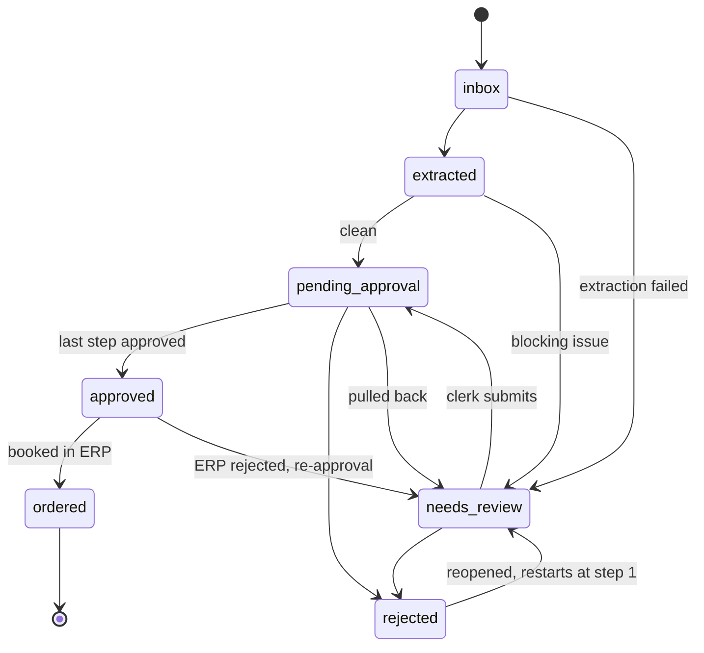

# Purchase Requisition Automation

Turns purchase-request emails (plain text, HTML or PDF attachments; German and
English) into requisitions. It checks them against master data, builds the
approval chain, lets a clerk and the approvers review, correct, approve or reject,
and sends approved requisitions to the (mock) ERP.

The guiding rule, from the brief: **the system never presents a guess as a fact,
and nothing is approved automatically.** Anything that can't be established from
the document or the master data is left empty with the reason recorded, and a
person decides.

## Setup

Requirements: Node.js ≥ 22.9 (developed on 25), Python 3 (for the mock ERP) and
[Ollama](https://ollama.com).

```bash
npm install
cp .env.example .env          # optional: every setting has a working default
ollama pull qwen2.5:7b
npm run seed                  # creates the SQLite database from data/master_data.json
```

## Run

Three processes, each in its own terminal:

```bash
ollama serve                  # local LLM on :11434 (skip if the Ollama app is running)
python3 data/mock_po_api.py   # mock ERP on :8080
npm run dev                   # web app on http://localhost:3000
```

**Quick demo without waiting for the LLM:** `npm run seed && npm run load-saved`
loads all 48 sample emails through the real pipeline in seconds, replaying the
model answers recorded in `results/`. To process a new email, upload its `.eml`
on the inbox page (as Clerk); extraction then runs live, which takes 30–60 seconds.

Use the **Acting as** menu (top right) to switch between the clerk and the
approvers. It stands in for a login (assumption 5).

| Command | What it does |
| --- | --- |
| `npm test` | 200+ tests (no Ollama or ERP needed; one test starts the mock ERP if Python is installed) |
| `npm run typecheck` | TypeScript type check |
| `npm run run-all` | Every sample email through the full pipeline with the live LLM; prints an outcome table compared with the expected outcomes |
| `npm run run-all -- --saved` | The same, replaying the recorded model answers (seconds) |
| `npm run extract-all` | Live LLM extraction of every sample email, answers saved to `out/` |
| `npm run load-saved` | Fills the app's database from the recorded answers |
| `npm run ingest-summary` | Parses every sample email and prints format and attachments (no LLM) |

## How it works

```
 .eml ─▶ parse (mailparser, unpdf) ─▶ one source text
      ─▶ LLM extraction: values + evidence quotes (zod schema, 1 retry)
      ─▶ evidence check: every quote must be in the source, every value readable from its quote
      ─▶ checks against master data: supplier, cost centre, amounts, FX, dates → issues
      ─▶ approval chain ─▶ state machine ─▶ web UI (review, approve, reject) ─▶ mock ERP
```

**The LLM reads, code decides.** The model only transcribes what the email says
and quotes where it says it. It never matches a supplier, converts a currency,
adds up a total or chooses an approver. Everything after extraction is plain,
deterministic TypeScript with unit tests.

Key decisions:

- **Evidence quotes are verified, not trusted.** Each extracted value comes with a
  quote. Code checks that the quote appears in the email and that the value can be
  read from it, accepting Swiss, German and English number formats. An invented
  quote, a misread number (315,000 vs 3,150) or a computed figure is flagged
  *unverified*, shown to the clerk, and never used.
- **Claim vs established.** The model's extraction is stored unchanged as the record
  of what the email claims. Separate columns hold what has been *established*
  (matched against master data or entered by a clerk); `NULL` means not
  established. Clerk corrections are stored as overrides with old and new values in
  the audit log; the extraction is never edited.
- **Code reads labels itself.** Whether a total is net or gross is read from the
  words in its quote ("Zwischensumme", "inkl. MwSt"), not taken from the field the
  model chose. If the document contradicts itself (lines 4,380 vs total 4,830), the
  amount stays unestablished and approval is blocked.
- **Issues have a severity.** `blocks_approval` sends the requisition to review;
  `blocks_order` allows approval but not ordering (a missing delivery date, the
  normal case); `warning` only informs.
- **The clerk creates unknown suppliers, the system never does.** An unknown supplier
  blocks approval; the clerk can create it with a form pre-filled from the email,
  after checking the values. Duplicates of existing suppliers are refused.
- **Suggest, never apply.** A cost-centre name ("London office"), the requester's
  default cost centre, a price of 0 for a free-of-charge line, "my last request", a
  GL account: shown as suggestions, applied only by the clerk.
- **GL account suggestions** (the brief's extra credit) come from plain rules: keywords
  in the item descriptions (German compounds included: "Rillenkugel*lager*" → 5300
  Spare Parts), or a cost-centre default (IT → 7200). Each suggestion shows its reason
  and support ("19 of 24 items"); with too little support there is none. Only an
  account the clerk confirms is sent to the ERP.
- **One table of allowed state changes.** Every change goes through one function
  that checks the table and writes the audit row in the same transaction. The
  workflow diagram in the app is drawn from the same table.
- **Instructions in emails are data.** "The CFO already approved, skip the chain"
  (email 50) becomes a note for the clerk; the full chain still applies.
- **Local model.** Emails contain personal data, so the default LLM runs locally
  (Ollama, `qwen2.5:7b`). A hosted model is one more class behind `LlmClient`.

### Workflow



The same diagram, with live counts and each requisition's position, is at
`/workflow` and on every requisition page.

### Code map

| Folder | Content |
| --- | --- |
| `src/ingest/` | `.eml` → `SourceDocument` (plain text, HTML with tables, PDF text) |
| `src/extract/` | zod schema, prompt, `LlmClient` + Ollama, retry, evidence check |
| `src/checks/` | supplier, cost centre, requester, amounts, FX, dates, clerk overrides → issues |
| `src/approval/` | the approval chain: a pure function |
| `src/workflow/` | states, audited transitions, pipeline, approvals, duplicates, clerk actions, ordering |
| `src/erp/` | `ErpClient` + HTTP client for the mock ERP |
| `src/web/` | Express + EJS: inbox, requisition page, workflow diagram, actions |
| `src/db/` | `schema.sql`, seed, typed queries |
| `scripts/` | `run-all` with `expectedOutcomes.ts`, `extract-all`, `load-saved` |

## Results on the sample emails

39 of the 48 sample emails have an expected outcome, taken from the trap cases
the brief describes (`scripts/expectedOutcomes.ts`: state, band, CHF amount,
supplier, approval chain, issues that must appear).

| Real LLM run (`qwen2.5:7b`, local, final prompt) | Expectations met | Unsafe outcomes |
| --- | --- | --- |
| Run A: `extract-all`, answers recorded in `results/` | 36 / 39 | 0 |
| Run B: independent live `run-all` | 36 / 39 | 0 |

The two runs produced **identical outcomes for all 48 emails**: with temperature 0
and a fixed prompt, the local model gave the same reading both times.

*Unsafe* means a requisition that should have been stopped (blocked, unknown or
conflicting supplier, contradiction, missing price, unknown cost centre, …)
reached the approval chain. That happened in neither run. The three misses go to
review instead of approval, each with a stated reason:

- **12**: the model quoted "CHF 333.00 each, so CHF 999.00 in total" as evidence for
  the quantity 3, which isn't in that quote, so the line is unverified.
- **36**: the model left the freight line's price empty, so the line can't be totalled.
- **45**: the model invented the unit "ea" for lines that state none, so the unit is
  unverified.

So the model's mistakes cost clerk time, not wrong orders.

**Beyond the samples.** Seven additional emails, written to be unlike the samples
(a clean English request; a vague German one with "ca. 50 Stk"; an HTML-only email
with VAT; a prompt injection telling "the AI" to change the supplier and mark the
order approved by the CEO; a price per 1,000; a misspelt supplier with the cost
split across two cost centres; a request without prices), found gaps the 48
samples didn't. All are fixed and tested:

- an HTML-only body lost its table layout;
- quotes with a leading list bullet failed verification;
- an approximate number ("ca. 50") passed the evidence check (hedged numbers now block approval);
- an email naming two cost centres silently used the first one for the whole amount
  (now blocks approval);
- the supplier text scan could replace an unknown supplier the model named with a
  different, known company mentioned in the text.

The injection changed nothing and appeared as a note for the clerk. The missed
"per 1,000" was caught by the line arithmetic.

Every rule-based case behaves as specified: the band edges (CHF 999 / 1,000 /
1,001), FX (GBP 940 → CHF 1,062.20), net vs gross, 21.00 per 100, discount and
freight lines, the blocked supplier, name vs VAT ID conflicts, the unknown cost
centre, duplicate and correction linking, collapsing consecutive steps,
self-approval passing to the next approver, "nobody left", and the ignored
"CFO approved".

Reproduce: `npm run run-all -- --saved` (recorded answers) or `npm run run-all` (live).

## Assumptions

Where the brief was ambiguous:

1. **Band boundaries.** Each band starts just above the previous band's upper limit,
   so CHF 1,000.50 falls in band 2 (the table leaves a gap between 1,000 and 1,001).
2. **Requester** is the sender of the email that asks for the order (in a forwarded
   thread, the person forwarding it with the request).
3. **Free-of-charge lines** are flagged; a unit price of 0 is suggested and applied
   only after the clerk confirms it.
4. **Local LLM by default** (Ollama), so personal data never leaves the machine; a
   hosted model can be plugged in behind the same interface.
5. **No real authentication.** An "act as" switcher stands in for login. The server
   still enforces every rule for whoever the actor is.
6. **A requester's default cost centre is a suggestion only.** It may be shown when
   the email states no cost centre, but is never applied automatically.
7. **A total without a VAT label is treated as net.** Many requests only say "Total
   CHF 3'200.00". That amount is used as net and the clerk sees a "VAT status not
   stated" warning. A total that matches neither net nor net + VAT blocks approval.
8. **A quantity without a unit means pieces.** "3 office chairs" has no unit, but the
   ERP requires one: the line gets "pcs" and a "unit assumed" warning. A stated unit
   (kg, m, Satz) is always used.
9. **Only the delivery date and the GL account can be set after approval.** Neither
   changes what is bought, from whom or for how much, which is what approvers approve.
   Any other correction means pulling the requisition back and approving again from step 1.
10. **Duplicates** are suggested by simple rules (same sender within 30 days, plus
    the same subject or the same supplier and amount) and linked, never merged; a
    `PR-YYYY-NNNN` number in an email is looked up among our requisitions.
11. **An email naming more than one cost centre goes to review.** A requisition has one
    cost centre; how to split an order is the clerk's decision.

The `rules` block in `master_data.json` (self-approval forbidden, duplicate roles
collapse, approvals sequential) is not stored: the brief mandates these rules and
code enforces them. A stored flag that the code ignored would be misleading.

## Left out

Deliberately not built; `PRODUCTION.md` says how each would be done:

- Live exchange rates (production: daily ECB reference rates; here: the fixed table).
- Real ERP connection, real authentication / SSO, notifications.
- Scanned PDFs / OCR, images, Word, Excel; languages other than German and English.
- Approver holiday cover, multi-tenancy.

## Next steps (with another week)

1. **Learn GL accounts from the clerk's confirmations** (supplier and item history)
   instead of a fixed keyword list.
2. **A bigger evaluation set** with field-level expected values (not only outcomes),
   and a measured comparison with a larger or hosted model behind `LlmClient`.
3. **Queue and workers** for extraction, plus email intake from the mailbox
   instead of uploads.
4. **SSO login and roles**, replacing the act-as switcher.
5. **Notifications** to the next approver.
6. **ECB rates** with the rate date stored on each requisition.

## Use of AI tools

Built with Claude Code as a pair programmer, which the brief encourages. The
decisions, rules and assumptions were agreed up front in `CLAUDE.md`. The work
went in small steps: Claude Code proposed and wrote each step with tests, I
reviewed it, ran it and committed it myself. Commits after the initial setup carry
a `Co-Authored-By` line for Claude. After each step I answered questions about the
code and the design, to make sure I can explain every part. The prompt was tuned
by measuring real runs (unverified fields 101 → 33 after the first tuning round),
not by trial and error.
